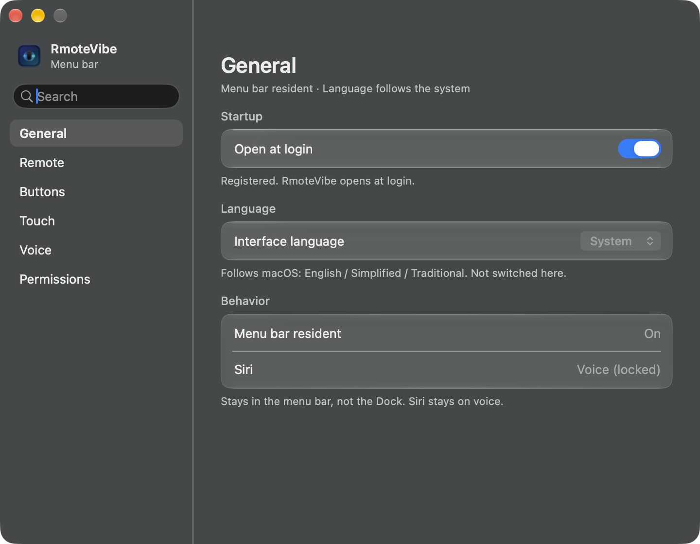
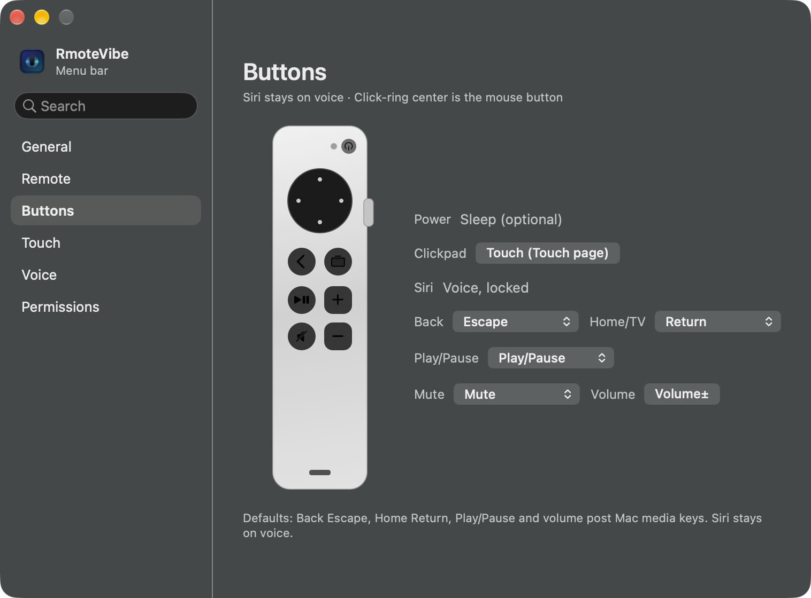
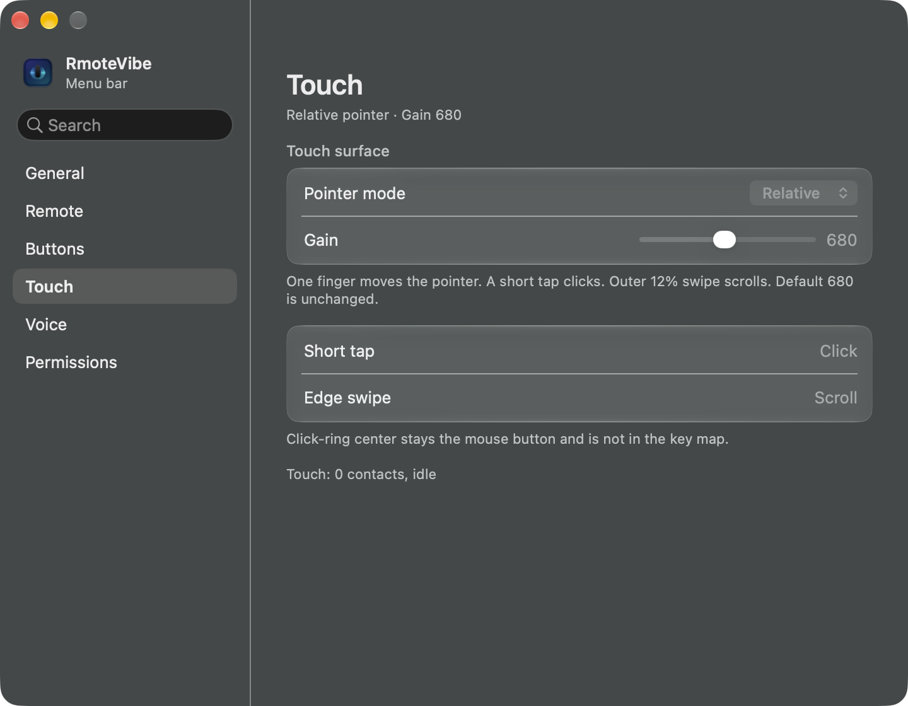
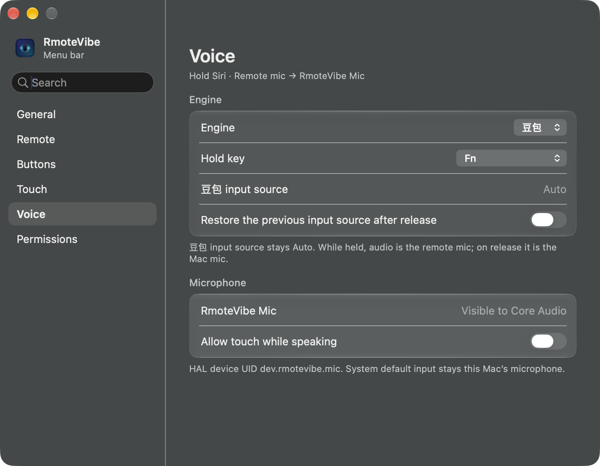

# RmoteVibe

Personal Mac menu-bar app. **Not** for the Mac App Store.

Use a **USB-C Apple TV Siri Remote** (model A2854, Apple VID `0x004C` PID `0x0315`, Bluetooth LE HID) as a pointer, keyboard, and push-to-talk mic on Apple Silicon macOS.

个人用的 Mac 菜单栏应用，**不上** Mac App Store。

把 **USB-C Apple TV Siri Remote**（型号 A2854，Apple VID `0x004C` PID `0x0315`，蓝牙 LE HID）当成 Apple Silicon Mac 的触控板、按键和按住说话麦克风。


<p align="center">
  
</p>

## Usage · 用法

- **Menu bar + Settings.** Lives in the menu bar. **Settings…** opens a glass sidebar window (General, Remote, Buttons, Touch, Voice, Permissions).
- **菜单栏 + 设置。** 驻留菜单栏。点 **设置…** 打开玻璃侧边栏窗口（通用、遥控器、按键、触控、语音、权限）。
- **Hold Siri = push-to-talk.** Holding the side Siri button feeds the remote mic into **RmoteVibe Mic** (HAL plugin). Doubao (豆包) or WeChat IME (微信输入法) does the recognition. Leave 豆包’s input source on **Auto**.
- **按住 Siri = 按住说话。** 按住侧面 Siri 键，遥控麦克风写入 **RmoteVibe Mic**（HAL 插件）。识别仍由豆包 / 微信输入法完成。豆包输入源保持 **自动**。
- **Touch.** Move the pointer, tap to click, edge-swipe to scroll, center-hold to drag. Default gain **680**.
- **触控。** 移动指针、点按、边缘滑动滚动、按住中心拖拽。默认增益 **680**。
- **Buttons.** Back, Home, Play/Pause, Mute, Volume are remappable. **Siri stays on voice.** Defaults: Back → Escape, Home → Return.
- **按键。** 返回、主页、播放/暂停、静音、音量可改。**Siri 只负责语音。** 默认：返回 → Escape，主页 → Return。
- **Permissions.** Grant **Accessibility** and **Input Monitoring** (and Bluetooth, Microphone, Login Items). An ad-hoc replace can drop TCC; toggle them again if that happens.
- **权限。** 需要 **辅助功能** 和 **输入监视**（以及蓝牙、麦克风、登录项）。临时签名换包可能丢掉授权，那时再开一次。

## Hardware · 硬件

| | |
| --- | --- |
| Remote · 遥控器 | USB-C Apple TV Siri Remote, model **A2854** |
| HID | Apple vendor `0x004C`, product `0x0315`, Bluetooth LE HID |
| Pairing · 配对 | Hold **Back + Volume Up** ~5 seconds until the light flashes · 按住 **返回 + 音量加** 约五秒直到灯闪 |
| Mac | Apple Silicon macOS |

The remote is exclusive: turn the Apple TV off or unplug it, or it reconnects there. Pair in RmoteVibe Settings or in Bluetooth settings. Connected means IOHID sees product `0x0315`. No serial number is required.

遥控器同时只能连一边：先关掉或拔掉 Apple TV。在 RmoteVibe 设置或系统蓝牙里配对。连上的标志是 IOHID 看到产品号 `0x0315`。不需要序列号。

## Screenshots · 截图

| General · 通用 | Buttons · 按键 |
| --- | --- |
|  |  |

| Touch · 触控 | Voice · 语音 |
| --- | --- |
|  |  |

## Build · 编译

Needs a Mac, Xcode, and [libopus](https://opus-codec.org/) (Homebrew: `brew install opus`). The Xcode project links `/opt/homebrew/lib/libopus.a` and includes `/opt/homebrew/include`.

需要 Mac、Xcode，以及 [libopus](https://opus-codec.org/)（Homebrew：`brew install opus`）。工程链接 `/opt/homebrew/lib/libopus.a`，头文件在 `/opt/homebrew/include`。

```bash
xcodebuild -project RmoteVibe.xcodeproj -scheme RmoteVibe -configuration Release \
  CODE_SIGN_IDENTITY="-" CODE_SIGNING_REQUIRED=NO
```

The app is signed **ad-hoc** (`CODE_SIGN_IDENTITY = "-"`). Copy `build/Release/RmoteVibe.app` to `/Applications`. Gatekeeper may ask you to open it anyway.

应用使用 **临时签名**。把 `build/Release/RmoteVibe.app` 拷到 `/Applications`。Gatekeeper 可能要你手动允许打开。

### HAL plugin · 音频插件（sudo 一次）

RmoteVibe Mic is a Core Audio HAL plug-in. Install it once from **Settings → Voice → Install RmoteVibe Mic** (AppleScript `sudo` prompt). That copies the driver to `/Library/Audio/Plug-Ins/HAL/RmoteVibeMic.driver` and restarts `coreaudiod`. Replacing the app later does not always reinstall the plug-in.

RmoteVibe Mic 是 Core Audio HAL 插件。在 **设置 → 语音 → 安装 RmoteVibe Mic** 装一次（会弹出管理员密码）。驱动拷到 `/Library/Audio/Plug-Ins/HAL/RmoteVibeMic.driver` 并重启 `coreaudiod`。以后只替换 App 不一定会重装插件。

Leave the **system default input** on the Mac microphone. Select **RmoteVibe Mic** once inside 豆包, or leave 豆包 on **Auto**.

系统默认输入保持 Mac 自己的麦克风。在豆包里选一次 **RmoteVibe Mic**，或保持 **自动**。

## Permissions · 权限

Grant these in System Settings. An ad-hoc rebuild can drop some of them, so toggle them again after replacing the app.

请在「系统设置」里打开这些权限。临时签名的新包可能丢掉已授权记录，替换 App 后要再开一次。

| Permission · 权限 | Why · 用途 |
| --- | --- |
| **Bluetooth** | Pair and reconnect the Siri Remote · 配对并重连遥控器 |
| **Accessibility** | Move the pointer, click, and post the talk key · 移动指针、点击、发出按住说话键 |
| **Input Monitoring** | Read HID from vendor `0x004C` product `0x0315` · 读取该 HID 设备 |
| **Microphone** | Play the Mac mic through RmoteVibe Mic when Siri is not held · 没按住 Siri 时把 Mac 麦送到虚拟麦 |
| **Login Items** | Open at login · 开机启动 |

## License

MIT. See [LICENSE](LICENSE).
