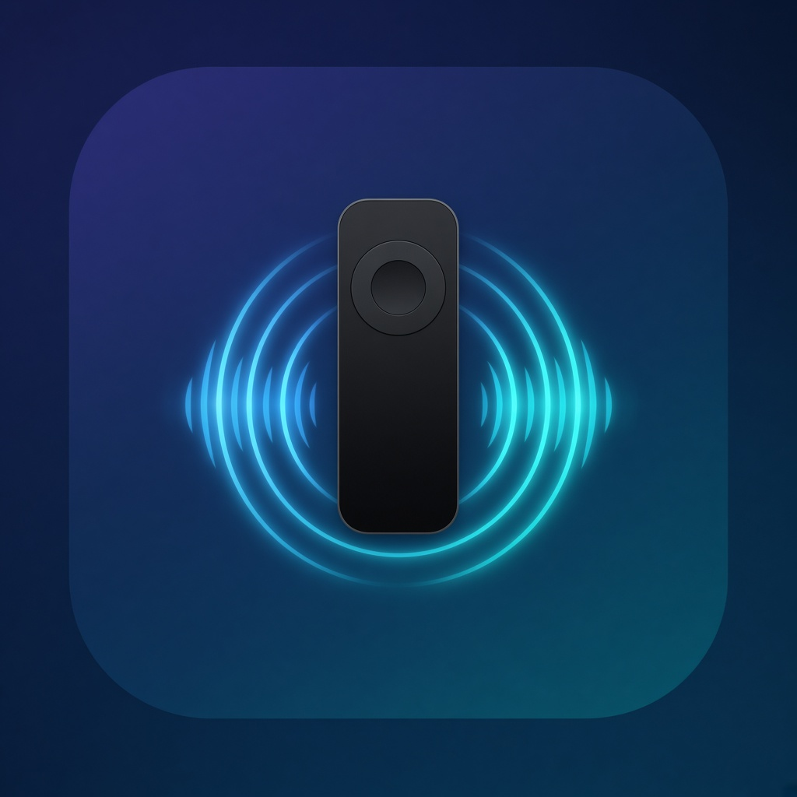
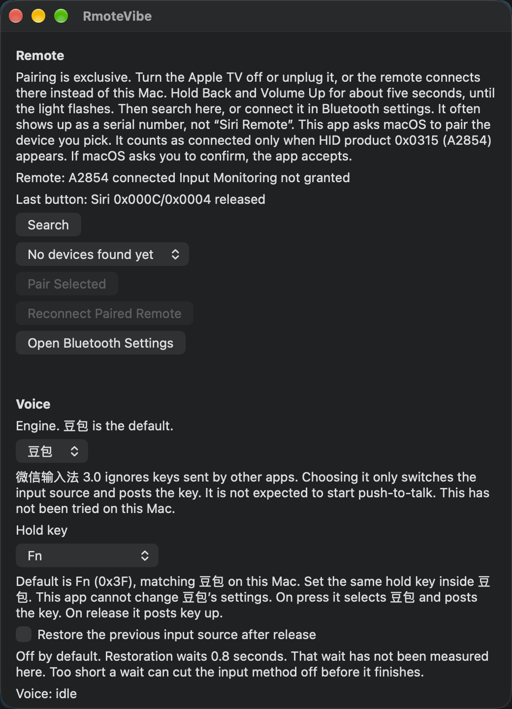

# RmoteVibe

Use an **Apple TV Siri Remote** (HID vendor `0x004C`, product `0x0315`, A2854) as a Mac pointer, keyboard, and push-to-talk mic.

Pair it in Bluetooth like any HID remote. RmoteVibe does **not** need the remote’s serial number.

用 **Apple TV Siri Remote**（HID 厂商 `0x004C`、产品 `0x0315`，A2854）当 Mac 的触控板、按键和按住说话麦克风。

在系统蓝牙里配对即可。序列号不是配置项。



<p align="center">
  
  
</p>

## Features · 功能

- **Hold Siri for 豆包 / WeChat.** Holding the side Siri button posts the talk key (Fn by default) and, while a Bluetooth HCI trace is readable, feeds the remote’s Opus voice into **RmoteVibe Mic**. 豆包 or 微信输入法 does the recognition. On release, the virtual mic goes back to the Mac microphone.
- **按住 Siri 给豆包 / 微信说话。** 按住侧面 Siri 键会发出按住说话热键（默认 Fn）。蓝牙 HCI 记录可读时，遥控器的 Opus 语音写入 **RmoteVibe Mic**。识别仍由豆包或微信输入法完成。松开后虚拟麦回到这台 Mac 的麦克风。
- **Trackpad.** One finger moves the pointer. A short tap clicks. An edge swipe scrolls. Click-ring center plus travel drags.
- **触控板。** 单指移动指针，短按点击，边缘滑动滚动。按住圆环中心再移动即可拖拽。
- **Button maps.** Back, Home, Play/Pause, Mute, Volume stay remappable in Settings. Siri stays on voice. Click-ring directions are not mapped in this version.
- **按键映射。** 返回、主页、播放/暂停、静音、音量可在设置里改。Siri 只负责语音。这一版不映射圆环方向键。
- **Login item.** Open at login via `SMAppService` (on by default; macOS may still ask in Login Items).
- **登录项。** 默认用 `SMAppService` 开机启动（系统仍可能要你在「登录项」里点一次允许）。

## Screenshots · 截图

| Menu bar · 菜单栏 | Settings · 设置 | App icon · 图标 |
| --- | --- | --- |
|  |  |  |

## Build · 编译

Needs a Mac, Xcode, and [libopus](https://opus-codec.org/) (Homebrew: `brew install opus`). The Xcode project links `/opt/homebrew/lib/libopus.a` and includes `/opt/homebrew/include`.

需要 Mac、Xcode，以及 [libopus](https://opus-codec.org/)（Homebrew：`brew install opus`）。工程链接 `/opt/homebrew/lib/libopus.a`，头文件在 `/opt/homebrew/include`。

```bash
xcodebuild -project RmoteVibe.xcodeproj -scheme RmoteVibe -configuration Release \
  CODE_SIGN_IDENTITY="-" CODE_SIGNING_REQUIRED=NO
```

The app is signed **ad-hoc** (`CODE_SIGN_IDENTITY = "-"`). Copy `build/Release/RmoteVibe.app` to `/Applications`. Gatekeeper may ask you to open it anyway.

应用使用 **临时签名**。把 `build/Release/RmoteVibe.app` 拷到 `/Applications`。Gatekeeper 可能要你手动允许打开。

### HAL plugin · 音频插件（sudo 一次）

RmoteVibe Mic is a Core Audio HAL plug-in. Install it once from **Settings → Install RmoteVibe Mic** (AppleScript `sudo` prompt). That copies the driver to `/Library/Audio/Plug-Ins/HAL/RmoteVibeMic.driver` and restarts `coreaudiod`. Replacing the app later does not always reinstall the plug-in.

RmoteVibe Mic 是 Core Audio HAL 插件。在 **设置 → 安装 RmoteVibe Mic** 装一次（会弹出管理员密码）。驱动拷到 `/Library/Audio/Plug-Ins/HAL/RmoteVibeMic.driver` 并重启 `coreaudiod`。以后只替换 App 不一定会重装插件。

Leave the **system default input** on the Mac microphone. Select **RmoteVibe Mic** once inside 豆包 (or Auto).

系统默认输入保持 Mac 自己的麦克风。在豆包里选一次 **RmoteVibe Mic**（或自动）。

## Permissions · 权限

Grant these in System Settings. An ad-hoc rebuild can drop some of them, so toggle them again after replacing the app.

请在「系统设置」里打开这些权限。临时签名的新包可能丢掉已授权记录，替换 App 后要再开一次。

| Permission · 权限 | Why · 用途 |
| --- | --- |
| **Bluetooth** | Pair and reconnect the Siri Remote · 配对并重连遥控器 |
| **Accessibility** | Move the pointer, click, and post the talk key · 移动指针、点击、发出按住说话键 |
| **Input Monitoring** | Read HID from vendor `0x004C` product `0x0315` · 读取该 HID 设备 |
| **Microphone** | Play the Mac mic through RmoteVibe Mic when Siri is not held · 没按住 Siri 时把 Mac 麦送到虚拟麦 |
| **Login Items** | Open at login · 开机启动 |

## Pairing · 配对

1. Turn the Apple TV off or unplug it. The remote is exclusive.
2. Hold **Back + Volume Up** about five seconds until the light flashes.
3. Search in RmoteVibe Settings, or connect it in Bluetooth settings. It often appears as a serial-looking name, not “Siri Remote”. You do not enter that serial anywhere.
4. Connected means IOHID sees product `0x0315`.

关掉或拔掉 Apple TV（遥控器同时只能连一边）。按住 **返回 + 音量加** 约五秒直到灯闪。在 RmoteVibe 设置里搜索，或到系统蓝牙里连接。设备名经常是一串序号，不是 “Siri Remote”；不必把它填进 App。连上的标志是 IOHID 看到产品号 `0x0315`。

## License

MIT. See [LICENSE](LICENSE).
